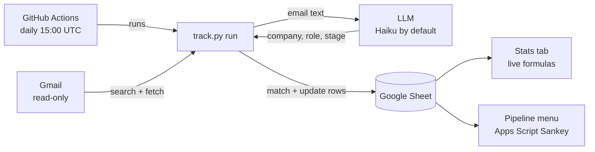

# job-tracker — Design Document

> Keeps a Google Sheet of job applications up to date by reading Gmail.

## 1. Problem

Tracking applications by hand drifts out of date. Every application already leaves an email trail (confirmation, OA, interview, rejection), so the tracker can be rebuilt from the inbox instead of typed in.

## 2. Goals and non-goals

**Goals**
- One row per company + role, with its current stage, kept current from Gmail.
- Grouped by recruiting season (Fall 2026, Spring 2027, …).
- Cheap: well under $1 per season.
- Safe: Gmail access is read-only; nothing private in the public repo.
- Readable: a clean sheet, a Stats tab, and a Simplify-style pipeline chart.

**Non-goals**
- Applying to jobs, or sending or replying to email.
- Perfect accuracy. Hand edits in the sheet are the correction path.
- A web app or database. Google Sheets is the UI and the storage.

## 3. Architecture



| Module | Job |
|---|---|
| `track.py` | CLI: `auth`, `new-season`, `run` (`--dry-run`, `--quiet`), `style` |
| `output.py` | Quiet mode: hides email details in CI logs; safe one-line errors |
| `.github/workflows/track.yml` | Daily scheduled run on GitHub Actions |
| `gmail_client.py` | Gmail search/fetch, retry with backoff, account-specific links |
| `classifier.py` | LLM adapters (Anthropic native, any OpenAI-compatible API), on-disk cache |
| `matcher.py` | Pure logic: matching, stage rules, ghosting, Reached tracking |
| `sheets.py` | Sheet I/O: seasons, rows, `_processed` log, schema upgrades |
| `sheet_style.py` | Formatting, Stats tab layout and formulas |
| `apps_script/Pipeline.gs` | Sankey chart, pasted into the sheet once |
| `google_auth.py`, `config.py` | OAuth token handling; `config.yaml` + `.env` |

## 4. Data model (the sheet)

**Season tab** (one per season; the active one is first):

| Company | Role | Stage | Date Applied | Last Update | Gmail Link | Notes | *Thread IDs* | *Reached* |
|---|---|---|---|---|---|---|---|---|

- Italic columns are hidden and used only by the script.
- **Gmail Link** shows "Open" and points at `?authuser=<account>`, so it opens the right inbox when several accounts are signed in.
- **Reached** lists every progress stage an application hit (`Applied,OA,Interview`), so rates and the chart survive a later rejection.

**Other tabs**
- **Stats**: season picker plus live formulas.
- **Seasons**: Name, Start, End, Active.
- **`_processed`** (hidden): Gmail message IDs already handled. This is the dedupe state, kept next to the data.

**Stages:** Applied → OA → Interview → Offer. Rejected and Withdrawn are final. Ghosted means 60 days with no email while Applied or OA.

## 5. How a run works

1. **Search** Gmail with ATS senders and subject keywords, from the earliest season that ended less than 90 days ago.
2. **Skip** message IDs already in `_processed`.
3. **Fetch** each email (body cut to 4,000 chars), oldest first.
4. **Classify** with the LLM into `{is_application_email, company, role, stage}`. Results are cached in `.cache/`, so reruns are free.
5. **Match** to a row:
   - The same Gmail thread wins, unless the roles clearly differ (ATS emails with the same subject get threaded together).
   - Otherwise: same normalized company plus a role match (≥75% overlap of meaningful title words, ignoring intern/season/year noise).
   - If several rows match, the newest wins.
   - A new "Applied" email more than 14 days after a rejection starts a new row (a re-application).
6. **Update**: stages only move forward, Reached grows, Last Update and the link follow the newest email.
7. **Ghost** stale Applied or OA rows, write changed rows, and log the processed IDs.

New rows go to the season whose dates contain the email. Late replies update the old season's row.

## 6. Key decisions

| Decision | Chosen | Why | Rejected alternative |
|---|---|---|---|
| Runtime | Python + Gmail API | Full control, testable, portable | Claude scheduled task: no code, but nondeterministic and hard to audit |
| Storage | Google Sheets | Phone access, hand edits, charts | Local CSV/Excel: only on one machine |
| Classifier | LLM with structured output | Handles messy wording ("unfortunately…") | Keyword rules: brittle |
| Provider | Pluggable; Haiku default | Users bring their own key; Ollama is free | Anthropic-only |
| Hand edits | Rows change only on new email; stages only move forward | Simple, no lock column needed | Locked / Needs Review columns (removed as clutter) |
| Season grouping | Tab per season, chosen by email date | Easy to read; old seasons keep updating | Single tab with a Season column |
| Pipeline chart | Apps Script + Google Charts Sankey | Sheets has no Sankey; stays live | Image rendered by Python (needs public Drive link) |
| Stats | Formulas, not script output | Updates instantly after hand edits | Python-computed numbers |
| Response rate | Dropped | Rejections aren't real responses; OA and Interview rates cover it | — |

## 7. Security and privacy

- **Gmail scope:** `gmail.readonly`. The Sheets scope covers only spreadsheets.
- **Secrets stay local and gitignored:** `credentials.json`, `token.json`, `.env`, `config.yaml`, `.cache/`.
- **The repo is public:** code and README only, with placeholder company names in tests. Old history contains one real role title, an accepted risk.
- **Public run logs:** quiet mode prints counts only. The first GitHub run's log was searched for the sheet ID, the account name, the school domain, company names, the season name, and key/token text: none found.
- **CI secrets:** stored as encrypted GitHub repo secrets. They can't be read back, are masked in logs, and aren't given to fork pull requests.
- **OAuth app:** published to In production with only the required branding: app name, contact emails, the repo as home page, and `PRIVACY.md` as the privacy policy, under authorized domain `github.com`. No logo, so no verification is needed. Users see an "unverified app" warning once.
- **Privacy policy:** `PRIVACY.md` discloses that the sender, subject, date and first 4,000 characters of each candidate email go to the chosen AI provider, and states Google API Limited Use compliance.
- **School account:** the school's Google Workspace blocks students from creating Cloud projects. The project lives in a personal account, with the school address added as a test user and used to log in.

## 8. Cost

| Item | Cost |
|---|---|
| Gmail API, Sheets API | Free |
| Claude Haiku 5.5, low effort | ~$0.0002–0.0005 per email (~$0.05 for the 161-email backfill) |
| Ollama (local) | Free, slower |
| GitHub Actions | Free (public repo) |

## 9. Testing

- **Unit tests** (`uv run pytest`): matching, stage rules, ghosting, Reached, link round-trip, Stats layout, provider config and JSON fallback, and the Sankey flow logic run under Node.
- **Live checks so far:** Anthropic and Ollama classify a sample email correctly. Reruns produce zero changes. The first GitHub Actions run (manual trigger) succeeded: `0 new emails · 0 added · 0 updated · 0 ghosted`.
- **Not live-tested:** OpenAI, Gemini, Groq, OpenRouter (no keys), and the Apps Script inside Sheets.

## 10. v2 — Automation with GitHub Actions (live)

**Goal:** the sheet updates daily without the Mac being on.

**Workflow:** `.github/workflows/track.yml`
- Triggers: a daily cron at 15:00 UTC (7am PST / 8am PDT) plus a manual "Run workflow" button (or `gh workflow run track.yml`). Never on pull requests.
- Steps:
  1. checkout,
  2. install uv,
  3. write `credentials.json`, `token.json` and `config.yaml` from repo secrets,
  4. `uv run track.py run`.
- `concurrency: tracker`, so two runs never overlap.
- No state between runs is needed, because `_processed` lives in the sheet.

**Secrets** (set with `gh secret set NAME < file`):

| Secret | Source |
|---|---|
| `GOOGLE_CREDENTIALS` | `credentials.json` (OAuth client from the personal-account Cloud project) |
| `GOOGLE_TOKEN` | `token.json` (login as the **school** account, made after publishing) |
| `CONFIG_YAML` | `config.yaml` (sheet ID, llm, ghosted_days, Gmail query) |
| `ANTHROPIC_API_KEY` | `.env` (or the chosen provider's key) |

**Code changes (done)**

| Change | Why |
|---|---|
| **Quiet mode** (auto-on when `GITHUB_ACTIONS` is set, or `--quiet`) | Public repo means public logs. Prints counts only; warnings become counts; crashes print e.g. `Gmail API error 429 (rate limited)` with no IDs. |
| **Non-interactive auth** | CI can't open a browser. Exits with "run `track.py auth` locally, then `gh secret set GOOGLE_TOKEN < token.json`". |
| **Workflow safety** | Triggers are only schedule + manual (never pull requests), `contents: read`, no `github.event` input, skips with a notice until secrets exist. |

**One-time setup (done 2026-11-12)**
1. Branding: app name, support and developer emails, home page = repo, privacy policy = `PRIVACY.md`, authorized domain `github.com`. Publishing was blocked until these were filled in.
2. Audience → **Publish app** (In production), then `uv run track.py auth` again as the school account. Logins made while in Testing keep the 7-day limit.
3. Uploaded the 4 secrets and triggered the first run: success.

**Quiet-mode output, before and after**

```
normal: 2026-11-10 upd [Fall 2026] <Company> | <Role> | Rejected  (stage Applied -> Rejected)
quiet : 12 new emails · 2 added · 5 updated · 1 ghosted
```

**When the Google login stops working**

The login made after publishing has no fixed expiry. It ends on a Google password change, revoked access, 6 months unused, roughly 100+ logins to the same app, the app going back to Testing, or a school admin policy. The run then fails with instructions. The fix:

```bash
uv run track.py auth                     # log in as the school account
gh secret set GOOGLE_TOKEN < token.json
```

GitHub emails on failed runs, so a broken login gets noticed.

**Risks**
- The school's Workspace may force re-logins regardless of app status; see the fix above.
- Scheduled runs can lag by up to an hour, and GitHub pauses schedules after 60 days without commits.
- A secret leaks only if printed. GitHub masks known secrets, and quiet mode avoids printing email data.

**Fallback:** launchd on the Mac. Private by default, but it only runs while the Mac is awake.

**Verified:**
- Locally, a simulated CI run (`GITHUB_ACTIONS=true`) prints one count line, and a CI run with no Google login exits 1 with re-login steps and never opens a browser.
- On GitHub, run #1 succeeded, and its log has no private data.

## 11. Open questions

- Does the school's session policy allow a long-lived refresh token? Watch whether runs keep succeeding past 7 days (after 2026-11-19).
- Should an "Accepted" or "Declined" stage follow Offer?
- Should a separate weekly digest (email or notification) be added?

## 12. Decision log

| Date | Change |
|---|---|
| 2026-11-12 | v1 built: Gmail → Haiku → Sheets, seasons, dedupe, dry-run |
| 2026-11-12 | Fixed role matching (word overlap), row placement, Gmail rate-limit retries, re-applications |
| 2026-11-12 | Removed Last Email Subject, Locked and Needs Review columns; hid Thread IDs |
| 2026-11-12 | Sheet styling, short "Open" links tied to the receiving account |
| 2026-11-12 | Stats tab, Reached column, Apps Script Sankey |
| 2026-11-12 | Pluggable LLM providers; README rewritten; repo made public |
| 2026-11-12 | Dropped Response rate; proposed v2 automation |
| 2026-11-12 | Built v2: quiet mode, CI-safe auth, daily GitHub Actions workflow |
| 2026-11-12 | Added PRIVACY.md; published OAuth app; uploaded secrets; first GitHub run succeeded, v2 live |
